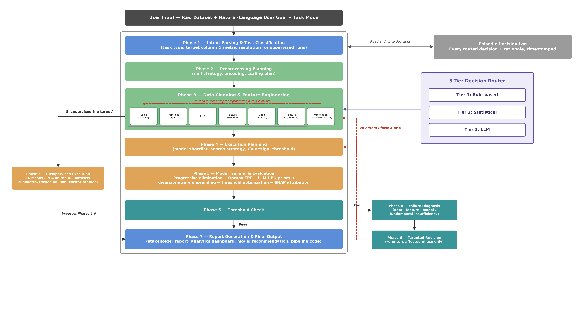

# LLM-Guided AutoML

An AutoML system that takes a raw tabular dataset and a plain-English goal, then runs the complete machine learning workflow through a seven-phase multi-agent pipeline built on [LangGraph](https://github.com/langchain-ai/langgraph) — and explains every decision it made.

Most AutoML frameworks are black boxes: they optimise a metric and hand back a model with no account of *why*. This system differs in three ways:

- **It reads your goal.** "Predict which patients are at risk of heart disease, prioritise catching every real case" changes which metric is selected and how the decision threshold is tuned. The goal is parsed, not ignored.
- **It only calls the LLM when it needs to.** A three-tier Decision Router resolves each preprocessing decision with a hard rule, a statistical check, or the LLM — in that order of preference. Across ten benchmark datasets, **71.7%** of decisions never reached the LLM.
- **Phases can see each other.** An episodic decision log persists across the whole run, so model selection knows what preprocessing did, and the final report can explain the entire chain in plain English.

## Results

Evaluated on ten public tabular datasets against AutoGluon, FLAML, an untuned Random Forest, and a linear baseline. Classification is F1 (weighted); regression is R². **Bold** = best.

| Dataset | Linear | Random Forest | FLAML | AutoGluon | **Ours** |
|---|---|---|---|---|---|
| Titanic | 0.8033 | 0.8038 | 0.8135 | 0.8022 | **0.8308** |
| Heart Disease | 0.8540 | 0.8806 | 0.8701 | 0.8751 | **0.8914** |
| Bank Marketing | 0.8070 | 0.8335 | 0.8359 | 0.8490 | **0.8616** |
| Customer Churn | 0.7838 | 0.7872 | 0.8001 | 0.7980 | **0.8050** |
| Credit Card Fraud | 0.9990 | 0.9992 | 0.9976 | 0.9989 | **0.9993** |
| Insurance | 0.8068 | 0.8818 | 0.9016 | 0.8991 | **0.9031** |
| House Prices | 0.6889 | 0.8746 | **0.9131** | 0.9100 | 0.8869 |
| Life Expectancy | 0.8192 | 0.9671 | **0.9725** | 0.9690 | 0.9724 |
| Diamonds | 0.9209 | 0.9823 | 0.9831 | **0.9846** | 0.9824 |
| Wine Quality | 0.3918 | 0.4556 | 0.4497 | 0.4692 | **0.4885** |

Highest score on **7 of 10** datasets — all five classification tasks and two of five regression tasks. AutoGluon and FLAML were each given a 90-second budget per dataset.

## Architecture



| Phase | Stage | Produces |
|---|---|---|
| 1 | Intent parsing & task classification | Target column, task type, resolved metric |
| 2 | Preprocessing planning (LLM) | High-level plan, carried forward as a prior |
| 3 | Preprocessing execution | Clean → split → EDA → feature selection → deep cleaning → feature engineering → verify |
| 4 | Execution planning | Model shortlist, search strategy, CV design, threshold |
| 5 | Model training & evaluation | Progressive elimination → Optuna TPE → ensembling → threshold tuning |
| 6 | Threshold check & failure diagnosis | Re-enters Phase 3 or 4 on failure, rather than restarting |
| 7 | Report generation | Stakeholder report, model recommendation, pipeline code |

Every phase reads from and writes to a shared **episodic decision log**, so no phase runs blind to what came before it. Phases 2–7 are a LangGraph `StateGraph`; when preprocessing output fails verification the graph rewinds to the failed sub-step, and when a run misses its performance threshold Phase 6 diagnoses the cause and re-enters only the affected phase.

### The three-tier Decision Router

Each column's imputation, outlier, encoding, scaling, and correlation decisions are assigned to the cheapest mechanism that can resolve them.

| Signal | Condition | Decision | Tier |
|---|---|---|---|
| Null rate | < 10% | Median / mode imputation | 1 — Rule |
| Null rate | 10–30% | Median / mode imputation | 2 — Statistical |
| Null rate | 30–70% | LLM decides | 3 — LLM |
| Null rate | > 70% | Flag as missing | 1 — Rule |
| Skewness | abs(skew) < 0.75 | No transform | 2 — Statistical |
| Skewness | abs(skew) in [0.75, 3.0) | LLM decides | 3 — LLM |
| Skewness | abs(skew) >= 3.0 | Log transform | 2 — Statistical |
| Correlation | r >= 0.97 | Drop lower-variance | 2 — Statistical |
| Cardinality | <= 10 unique | One-hot encoding | 1 — Rule |
| Cardinality | 11–100 unique | LLM decides | 3 — LLM |
| Cardinality | > 100 unique | Ordinal encoding | 1 — Rule |

Only Tier 3 reaches the LLM. Total LLM calls per run stay between 11 and 13 regardless of dataset size.

## What's new

Recent additions on top of the seven-phase supervised pipeline:

### Unsupervised mode (clustering & dimensionality reduction)
- **No target column needed.** The chat input has a mode toggle: *Predict a target* or *Find patterns / reduce dimensions*. In the second mode the UI sends `task_type: "clustering"` to `/run`, so Phase 1 skips intent parsing and target/metric resolution.
- **Separate graph branch.** After `basic_cleaning`, the orchestrator forks (`route_after_basic_cleaning`) into a new `unsupervised_train` node and then straight to `phase7_final_output`. There is no split, CV, threshold loop, or retry — the run happens once on the full cleaned dataset.
- **New module** [automl_system/pipeline/unsupervised.py](automl_system/pipeline/unsupervised.py). Defaults: K-Means (k searched up to 8 by silhouette) for clustering and PCA for dimensionality reduction. GMM, Agglomerative, DBSCAN, HDBSCAN, t-SNE, and UMAP (optional dependency) are implemented and selectable via the `algorithm` parameter, but not yet exposed in the UI. Identifier-like columns (IDs) are detected and excluded automatically.
- **Internal validation** instead of held-out scores: silhouette, Davies-Bouldin, inertia, explained variance, per-cluster sizes, and per-cluster top distinguishing features (z-scores).
- **Dedicated report prompt** (`_generate_unsupervised_report` in [report_generator.py](automl_system/agents/report_generator.py)) with its own sections and a deterministic fallback, so the supervised report prompt is untouched. Supervised-only outputs (pipeline script, comparison table) are left empty for these runs.
- New session field `unsupervised_results`; new sample datasets `Mall_Customers.csv` and `CC_Cluster.csv` in `experiments/datasets/`.

### Analytics page
A new **📊 Analytics** tab (next to *Pipeline*) appears once a run finishes — [AnalyticsPage.jsx](frontend/src/components/AnalyticsPage.jsx) and [UnsupervisedResults.jsx](frontend/src/components/UnsupervisedResults.jsx):
- Decision Router breakdown (rule / statistical / LLM share, and % of decisions resolved without an LLM call)
- SHAP feature-impact chart
- Model comparison table
- Diagnostic plots: confusion matrix (classification) or actual-vs-predicted scatter (regression)
- For unsupervised runs: cluster sizes, 2-D projection scatter, cluster profiles, and plain-language interpretations of silhouette and Davies-Bouldin

### SHAP explainability
[automl_system/utils/shap_explainer.py](automl_system/utils/shap_explainer.py) computes a ranked feature-impact summary for the winning Phase 5 model, using the cheapest valid explainer: `TreeExplainer` (RF / ExtraTrees / GB / XGBoost / LightGBM / CatBoost), `LinearExplainer` (linear models), or a sample-capped `KernelExplainer` (MLP / SVM / KNN). Result is stored in `session.shap_summary`; failures degrade to `{"available": false}` rather than breaking the run. Phase 5 also now emits a capped (300-point) actual-vs-predicted sample for regression.

### Other changes
- **Phase 1 summary** now renders the task understanding as three short lines (goal / problem type and metric / dataset size) instead of one dense paragraph.
- **`server.py`** — `/run` accepts an optional `task_type`; the Phase 1 logic was restructured into unsupervised and supervised branches; `unsupervised_train` is registered as a Phase 5 stage in the progress stream.
- **Frontend** — mode toggle, view switcher, new styles, `CLUSTER_COLORS` palette; `frontend/dist/` rebuilt.
- **Architecture diagram** script and figure (`fig0_system_architecture`) updated.
- **Dependencies** — added `shap` and (optional) `umap-learn` to `requirements.txt`.

## Installation

Requires **Python 3.12+** and a running **MongoDB** instance (for the episodic decision log).

```bash
git clone https://github.com/krittika019/LLM-Based-AutoML.git
cd LLM-Based-AutoML

python -m venv .venv
source .venv/bin/activate        # Windows: .venv\Scripts\activate

pip install -r requirements.txt
```

AutoGluon is intentionally left out of `requirements.txt` (~2 GB install). It is only needed to reproduce the benchmark comparison:

```bash
pip install autogluon.tabular
```

## Configuration

```bash
cp .env.example .env
```

Then fill in at minimum an LLM API key and your MongoDB URI:

```ini
LLM_PROVIDER=groq                 # groq | cerebras | together | openai | ollama
LLM_FALLBACK_PROVIDER=cerebras    # used automatically if the primary rate-limits
GROQ_API_KEY=your_key_here
MONGODB_URI=mongodb://localhost:27017
```

Two model tiers are used: a fast model for structured JSON and EDA narration, and a larger one for the two reasoning-heavy phases (failure diagnosis and report generation). Defaults are `llama-3.1-8b-instant` and `llama-3.3-70b-versatile`, overridable via `LLM_FLASH` and `LLM_PRO`.

## Usage

### Web interface

```bash
uvicorn server:app --reload --port 8000
```

Open http://localhost:8000. Upload a CSV, describe your goal in plain English, and watch the run stream phase by phase.

To develop the frontend with hot reload:

```bash
cd frontend
npm install
npm run dev          # production build: npm run build
```

The built frontend in `frontend/dist/` is committed so the FastAPI server can serve it without a Node runtime in production.

### API

| Method | Endpoint | Purpose |
|---|---|---|
| `POST` | `/upload` | Upload a CSV dataset |
| `POST` | `/run` | Start a pipeline run (optional `task_type` for unsupervised mode) |
| `GET` | `/stream/{run_id}` | Server-sent events for live progress |
| `GET` | `/download/script/{run_id}` | Download the generated pipeline script |
| `GET` | `/download/report/{run_id}` | Download the stakeholder report |

## Reproducing the benchmark

```bash
# All ten datasets, every system
python experiments/benchmark.py

# A subset
python experiments/benchmark.py --datasets titanic,heart,wine

# Our pipeline only, or competitors only
python experiments/benchmark.py --only-ours
python experiments/benchmark.py --skip-automl

# Change the competitor time budget (default 90s)
python experiments/benchmark.py --automl-time 120

# Merge per-dataset results into benchmark_results.csv
python experiments/benchmark.py --merge
```

Results land in `experiments/results/`. Figures are regenerated with `python experiments/generate_figures.py`.

Datasets live in `experiments/datasets/`. `creditcard.csv` is excluded from version control (144 MB, over GitHub's per-file limit) — download it from [Kaggle](https://www.kaggle.com/datasets/mlg-ulb/creditcardfraud) and place it there.

## Tests

```bash
pytest tests/
```

## Project structure

```
automl_system/
  agents/      intent parsing, task classification, preprocessing and pipeline
               planning, failure diagnosis, report generation
  graph/       LangGraph orchestrator — nodes, edges, and retry routing
  pipeline/    cleaning, EDA, feature selection/engineering, training,
               verification, pipeline-script generation, unsupervised
               clustering / dimensionality reduction
  memory/      episodic decision log (MongoDB-backed)
  utils/       decision router, dataset profiling, decision log, JSON repair,
               SHAP explainer
  llm/         multi-provider LLM client with automatic fallback
  state/       shared session state passed between phases
experiments/   benchmark harness, ablations, figure generation
frontend/      React + Vite UI
server.py      FastAPI backend
tests/         end-to-end tests
```

## Limitations

Tabular data only. Time series, image, and text data are not supported, nor are semi-supervised settings. Unsupervised support (clustering and dimensionality reduction) is a single-pass v1: no iterative retry loop, no LLM-guided algorithm selection, and only K-Means and PCA are reachable from the UI. Runtime is longer than AutoGluon or FLAML — the pipeline is sequential and also generates rationales and a natural-language report on every run, which those systems do not do.

## Citation

If you use this work, please cite:

```bibtex
@inproceedings{bisht2026llmautoml,
  title     = {An {LLM}-Guided Multi-Agent System for Automated and
               Interpretable Machine Learning on Tabular Data},
  author    = {Bisht, Krittika and Pawa, Manasvi and Saboo, Shreyansh
               and Sharma, Aditi},
  booktitle = {},
  year      = {2026}
}
```

## License

Released under the MIT License — see [LICENSE](LICENSE).
